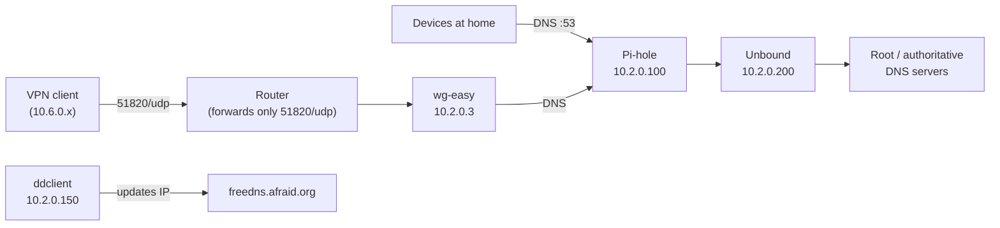

# Self-Hosted DNS + VPN Stack (Pi-hole + Unbound + WireGuard + FreeDNS)

A small self-hosted stack for a home server (e.g. a Raspberry Pi), managed with Docker Compose:

- **Pi-hole**: network-wide ad-blocking DNS server
- **Unbound**: recursive DNS resolver, so Pi-hole doesn't forward your queries to Google/Cloudflare
- **WireGuard ([wg-easy](https://github.com/wg-easy/wg-easy) v15)**: VPN with a web UI for managing clients
- **FreeDNS ([ddclient](https://ddclient.net/))**: keeps a free dynamic DNS name pointed at your home IP

VPN clients get the same ad-blocking as devices at home, and the web UIs are only reachable from the
LAN or through the VPN.



All containers share the Docker network `10.2.0.0/24`. VPN clients get addresses from `10.6.0.0/24`.

---

## 1. Prerequisites

- **Docker** and the **Docker Compose plugin**:
  [Docker install guide](https://docs.docker.com/engine/install/) ·
  [Compose plugin](https://docs.docker.com/compose/install/linux/)
- **A fixed LAN IP for the server.** Give it a DHCP reservation in your router so its address never
  changes. All examples below use `192.168.178.10`; replace it with yours.
- **A 64-bit OS** (arm64 or x86_64). wg-easy v15 doesn't support armv6/armv7.

---

## 2. Router

### Port forwarding: forward ONLY `51820/UDP`

| Port | Forward? | Why |
|---|---|---|
| `51820/udp` (WireGuard) | **Yes** | The VPN itself. This is the only port that needs to be reachable from the internet. |
| `53` (DNS) | **Never** | It would turn your server into an open resolver that gets abused for attacks. |
| `8080` (Pi-hole UI), `51821` (wg-easy UI) | **Never** | Plain-HTTP admin pages. Reach them from home or through the VPN instead. |

Also check IPv6 port sharing, which many routers (e.g. FritzBox) configure separately from IPv4.

### Use the server as the network's DNS

Point your router's local DNS server to the server's IP, so all devices at home use Pi-hole.
On a FritzBox: **Home Network → Network → Network Settings → IPv4 Settings → Local DNS server**.

### FritzBox: DNS rebind protection

FritzBox blocks DNS answers that point to private IPs. Add your FreeDNS hostname as an exception under
**Home Network → Network → Network Settings → DNS Rebind Protection**.

---

## 3. FreeDNS hostname

1. Create an account at [freedns.afraid.org](https://freedns.afraid.org/) and add a subdomain
   (e.g. `my-vpn.chickenkiller.com`) pointing to your public IP.
2. Use a **long, unique password** for the account. ddclient logs in with it, and anyone who has it can
   repoint your hostname.

---

## 4. Configure

```bash
git clone https://github.com/andreaperin/dns-vpn-stack.git
cd dns-vpn-stack
```

### `.env`

```bash
cp .env.example .env
chmod 600 .env
nvim .env
```

| Variable | Meaning |
|---|---|
| `TZ` | Time zone, `Region/City`, e.g. `Europe/Berlin` |
| `PIHOLE_PW` | Password for the Pi-hole web UI |

`.env` is git-ignored. Never commit it.

### ddclient (FreeDNS updater)

The ddclient container reads **only** its config file, not environment variables:

```bash
mkdir ddclient
cp ddclient.conf.example ddclient/ddclient.conf
chmod 600 ddclient/ddclient.conf
nvim ddclient/ddclient.conf
```

Set `login=` and `password=` to your FreeDNS account, and replace the last line
(`your-subdomain.example.com`) with your hostname. The `ddclient/` folder is git-ignored.

---

## 5. Start the stack

```bash
docker compose up -d
docker compose ps
```

All four containers (`unbound`, `pihole`, `wg-easy`, `freedns`) should show `Up`.

---

## 6. First-time setup

### wg-easy (VPN)

Open `http://192.168.178.10:51821` **from your LAN**. The setup wizard runs once:

1. Create the admin account. Store the password in a password manager.
2. **Host**: your FreeDNS hostname. **Port**: `51820`.
3. Then, in **Admin → Config**:
   - Check that **Host** is filled in. The wizard sometimes leaves it empty, and saving any other
     setting then fails with "host must be at least 1 character".
   - Set **DNS** to `10.2.0.100` (Pi-hole) and remove any other entries, so VPN clients use Pi-hole.

Then create a client per device, and scan the QR code or import the config in the WireGuard app.

Data (clients, keys, settings) lives in `~/wireguard-v15` on the host. Back this folder up.

### Pi-hole

Open `http://192.168.178.10:8080/admin` and log in with `PIHOLE_PW`.

These settings come from `docker-compose.yml` and appear read-only in the UI:

- upstream DNS = Unbound (`FTLCONF_dns_upstreams: '10.2.0.200#53'`)
- listening mode = all (`FTLCONF_dns_listeningMode: 'all'`)

**Adding blocklists:**

1. **Group Management → Lists**: paste a list URL (e.g. from [Firebog](https://firebog.net/)), click **Add**.
2. **Tools → Update Gravity → Update**.

> ⚠️ Start with a few trusted lists. Too many lists can slow things down or block legitimate sites.

---

## 7. Check that everything works

```bash
# DNS through Pi-hole
dig +short @127.0.0.1 example.com

# DNSSEC validation by Unbound (should print status: SERVFAIL)
dig @127.0.0.1 dnssec-failed.org | grep status:

# VPN: listening port and connected clients
docker exec wg-easy wg show

# FreeDNS update (should print status-ipv4=good)
docker exec -u abc freedns ddclient -file /config/ddclient.conf -cache /tmp/c -daemon=0 -force
docker exec freedns grep -o 'status-ipv4=[a-z]*' /tmp/c
```

For the VPN, test from a phone on **mobile data** (Wi-Fi off): connect, open a website, and check that
`wg show` lists a recent handshake for that client.

---

## 8. Maintenance

### Updates

```bash
docker compose pull
docker compose up -d
docker image prune
```

Images are tagged `latest`, except wg-easy, which is pinned to major version `15`. Read the wg-easy
release notes before moving to a new major version.

### Backups

What to back up (it contains secrets, so store it encrypted):

- `.env`
- `ddclient/ddclient.conf`
- `etc-pihole/` and `etc-dnsmasq.d/`
- `~/wireguard-v15/`

```bash
sudo tar czf ~/backups/vpn-stack-$(date +%F).tgz .env ddclient etc-pihole etc-dnsmasq.d ~/wireguard-v15
```

### Upgrading from wg-easy v13/v14

v15 imports the old `wg0.json` in its setup wizard, and the clients keep their keys and IPs, so devices
don't need new configs.

1. Back up the old data folder.
2. Start v15 with a **new, empty** data folder.
3. In the wizard, choose the option for an existing configuration and upload the old `wg0.json`.

The old `PASSWORD` / `WG_*` environment variables are no longer used. Those settings live in the web
UI. See the [official migration guide](https://wg-easy.github.io/wg-easy/latest/advanced/migrate/from-14-to-15/).

---

## Security notes

- Only `51820/udp` should be reachable from the internet.
- The web UIs use plain HTTP (`INSECURE=true` for wg-easy). Use them only from the LAN or the VPN.
- Keep `.env`, `ddclient/ddclient.conf` and `~/wireguard-v15` private (`chmod 600` / root-owned).
  They contain passwords and VPN private keys.
- Use long, unique passwords for Pi-hole, wg-easy and FreeDNS.
